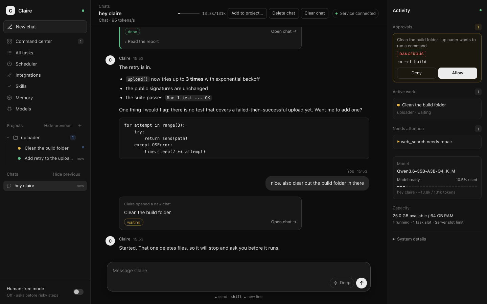
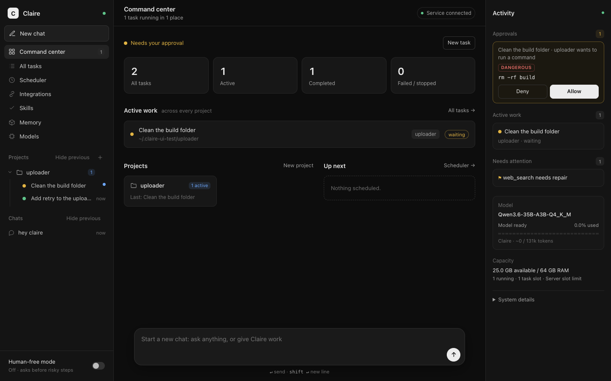
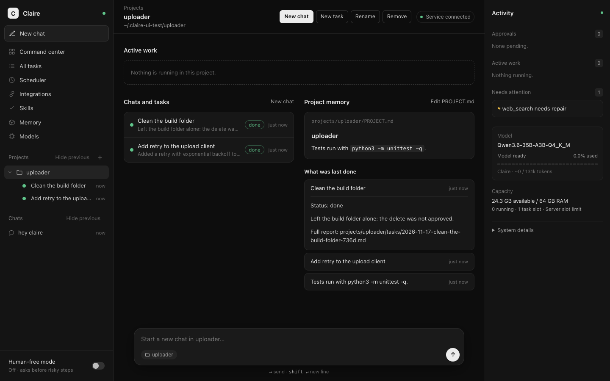

# Getting started with Claire

For the current clone-and-start steps on either operating system, see the
[README](README.md#clone-and-start). The walkthrough below focuses on macOS;
native [Windows setup](#windows-with-lm-studio) is covered later in this guide.

Claire is an AI assistant that runs entirely on your own Mac. The model, your
chats, her memory and every file she touches stay on your machine. There is no
cloud API, no account and no per-token cost. You talk to her in a local web app;
she answers, and for real work (code, research, files) she starts a task that
works in its own sandboxed folder and reports back.



This guide takes you from nothing to a working Claire in about 15 minutes, most
of which is downloading a model.

---

## What you need

| | |
|---|---|
| **A Mac with Apple Silicon** (M1 or later) | Claire also runs on Linux, but the OS sandbox that confines her commands is macOS only. |
| **RAM** | 16 GB works with a small model. 32 GB or more is comfortable. See [Choosing a model](#3-get-a-model). |
| **Python 3.9 or newer** | Already on most Macs. Check with `python3 --version`. If it is missing, run `xcode-select --install`. |
| **Homebrew** | To install llama.cpp. Get it from [brew.sh](https://brew.sh). |
| **About 5–20 GB of disk** | For the model file. |

Claire herself needs nothing else: she uses only Python's standard library, so
there is no `pip install` and no virtual environment.

---

## 1. Clone the repository

```bash
git clone https://github.com/SohamNehra/Claire-V2.git
cd Claire-V2
```

Everything below is run from this folder.

## 2. Install llama.cpp

Claire runs models with `llama-server`, part of llama.cpp. She starts it
herself when she needs it; you only install it once:

```bash
brew install llama.cpp
```

Check it worked: `llama-server --version`.

> Prefer [LM Studio](https://lmstudio.ai)? That works too. Skip this step and see
> [Using LM Studio instead](#using-lm-studio-instead).

## 3. Get a model

Claire needs a model in **GGUF** format (a single `.gguf` file). Pick one that
fits your memory. A model needs roughly its file size in free RAM, plus a few GB
for its working memory (its *context*).

| Your Mac's RAM | Model size to look for | File size (4-bit, `Q4_K_M`) |
|---|---|---|
| 16 GB | 4B–8B parameters | 3–5 GB |
| 32 GB | 8B–14B parameters | 5–9 GB |
| 64 GB or more | 14B–32B parameters | 9–20 GB |

Bigger models reason better; smaller ones answer faster. A recent **Qwen**
model of the right size is a good start. Look for a file ending in
`Q4_K_M.gguf`, which is the usual balance of quality and size.

The easiest way to download one is with [LM Studio](https://lmstudio.ai): use
its search, download the model, and it saves the file under
`~/.lmstudio/models/`. You can also download a `.gguf` file directly from
[Hugging Face](https://huggingface.co/models?library=gguf). Either way, all
Claire needs is the path to the file.

> If a model is split into several files (`…-00001-of-00003.gguf`), keep the
> parts together and give Claire the first one.

## 4. Point Claire at your model

From the repository folder:

```bash
./claire2 models add ~/path/to/your-model.gguf
```

Claire reads the file, checks it is a real GGUF model, and tells you the name
she gave it. Then choose it:

```bash
./claire2 models use your-model-name
```

`./claire2 models` lists every model and marks the one Claire will use.
Optional flags for `add`:

- `--name "Qwen 8B"` sets the name she shows.
- `--context 65536` sets how many tokens the model reads at once. The default
  is 32,768, or less if the model was trained for less; larger uses more memory.

You can also do all of this in the app (step 6).

## 5. Start Claire

```bash
./claire2 app
```

This starts Claire's local service in the background, loads your model, and
opens the app in your browser. The first start takes a little longer while the
model loads into memory.

The service keeps running after you close the browser, so tasks can finish.
Useful commands:

```bash
./claire2 status            # is she running, which model, how much context
./claire2 app               # open the app again (starts the service if needed)
./claire2 stop              # stop the service; the model stays loaded for a quick restart
./claire2 stop --unload     # stop the service and the model, freeing its memory
```

To run `claire2` from any folder, link it onto your PATH:

```bash
mkdir -p ~/.local/bin && ln -s "$(pwd)/claire2" ~/.local/bin/claire2
```

## 6. Set a model from the app

Open **Models** in the sidebar.

1. Click **Add model**.
2. Leave *Runs with* on **llama.cpp**, click **Browse…** and choose your
   `.gguf` file in the Finder. Claire shows the model's name, size and how much
   context it was trained for, and fills in sensible values.
3. Keep **Use this model** ticked and click **Add model**.
4. Click **Restart Claire now**. She unloads the old model, frees its memory,
   and comes back on the new one. The page reconnects by itself.

Models you add, and which one is in use, are saved in `~/.claire/models.json`.
That choice takes precedence over `config.py`.

---

## Using Claire



- **Chats.** Click **New chat**, or type on the command center. Ask questions
  directly. Give her real work ("add tests for utils.py in ~/code/app") and she
  starts a **task**: a separate worker with its own context, confined to that
  folder, which reports back to the chat when it is done.
- **Projects.** Work is organised in projects, as in a code editor's
  workspace. A project usually is a folder (a repository); its chats and tasks
  are listed under it, and it has its own memory. The first task in a folder
  creates its project. Add one yourself with **+** next to *Projects* (use
  **Browse…** to pick the folder), or just ask: "make a project for ~/code/app".
- **Memory.** Each project has a `PROJECT.md` (what the project is, how work is
  done there; edit it on the project page) and a dated log of what was done.
  Every chat and task also gets a short shared index of everything Claire knows
  (about you, recent work, each project, notes she has learned), one line per
  memory with the file holding the detail. She reads a file in full only when
  she needs it. It is all plain Markdown in `~/claire-vault`, so you can open it
  in Obsidian or any editor.
- **Command center.** Everything running in every project, at a glance.
- **Skills, Integrations, Scheduler.** Teach her how you want kinds of work done
  (skills are Markdown files you write), connect services such as Gmail or an
  MCP server, and set recurring jobs ("every weekday at nine, brief me").



## Safety

Claire can run commands, so she is boxed in by three layers:

1. **An OS sandbox** (macOS Seatbelt). A task can write only inside its own
   folder and cannot read your credentials (SSH keys, cloud logins, keychains,
   browser profiles).
2. **A forbidden list.** Commands such as `sudo` or deleting your home folder
   are refused outright, in every mode.
3. **Approval.** Risky steps (deleting files, `git push`, installing packages,
   leaving the sandbox, sending a message from one of your apps) stop and wait
   for you in the *Activity* panel. Unanswered requests expire as a no.

**Human-free mode** (the switch at the bottom of the sidebar) lets her go ahead
without asking for ordinary steps, such as installing packages and browsing.
She still asks before anything that deletes or is dangerous. Only you can turn
it on.

## Using LM Studio instead

1. Install [LM Studio](https://lmstudio.ai), download a model, and keep LM Studio open.
2. In Claire, open **Models → Add model**, set *Runs with* to **LM Studio**, and
   pick the model from the list. (From a terminal: `./claire2 models add-lmstudio MODEL_KEY`,
   using the key LM Studio shows for the model.)
3. Click **Restart Claire now**.

## Troubleshooting

| Problem | What to do |
|---|---|
| `llama-server is not installed` | `brew install llama.cpp`, then restart Claire. |
| The model never becomes ready | Run `./claire2 status`. Check `~/.claire-server.log` (llama.cpp's log) and `~/.claire/service.log`. Most often the model does not fit in memory: choose a smaller model or a smaller context. |
| "Splash runtime is not installed" | The repository's `config.py` is set up for the author's machine. Add your own model (step 4 or 6); it takes precedence. |
| "Claire's service is running older code than this page" | `./claire2 stop`, then `./claire2 app`. |
| Port already in use | Another program uses Claire's port (8765) or the model's (8090 and up). Stop it, or change `SERVICE_PORT` in `config.py`. |
| She asks for approval too often | Turn on human-free mode, or answer **Allow** in the Activity panel. |

Everything Claire knows about her own setup is in `config.py`, with comments.
`python3 config.py` prints what every setting resolves to.

## Windows with LM Studio

Install LM Studio and download a model. Then double-click **Setup Claire.cmd**
once, followed by **Start Claire.cmd**. Setup uses Python 3.9+ or uv to create a
project-local environment; it does not change your system execution policy.
You can also run `powershell -NoProfile -ExecutionPolicy Bypass -File .\claire2.ps1`.
The launcher opens the app, starts LM Studio's loopback server if needed, and
keeps chats/settings in `.claire/` and notes in `claire-vault/` beside this
project. It uses `.venv\Scripts\python.exe`. `tzdata` and `tzlocal` provide the
timezone database and Windows timezone-name translation used by chats and schedules.
If LM Studio has exactly one downloaded language model and Claire has no saved
choice, the launcher selects it with up to 32,768 tokens of context. If there
are several models, choose one on the Models page before chatting.
Windows known folders come from the OS, so OneDrive redirection, translated
folder names and relocated folders are supported. Existing projects can live
on another local drive.

For a fresh checkout with Python 3.9+ and uv installed:

```powershell
uv venv --python 3.12
uv pip install --python .venv\Scripts\python.exe -r requirements-windows.txt
powershell -NoProfile -ExecutionPolicy Bypass -File .\claire2.ps1 models add-lmstudio YOUR_MODEL_KEY --name "My local model" --context 32768
powershell -NoProfile -ExecutionPolicy Bypass -File .\claire2.ps1 models
# Use the name printed by the add command:
powershell -NoProfile -ExecutionPolicy Bypass -File .\claire2.ps1 models use my-local-model
```

Other commands: `powershell -NoProfile -ExecutionPolicy Bypass -File .\claire2.ps1 status`
or replace `status` with `stop` (or `stop --unload` to free the model's memory).
Approved shell commands use Windows PowerShell. The macOS OS sandbox,
native Mac computer controls, Apple Notes, local sandboxed Browser/MCP,
workshop/integration-builder execution, Finder choosers and login autostart are
unavailable on Windows; command approvals remain enabled. Windows supports chat,
file navigation, project/task work, approved PowerShell commands, memory,
schedules, and remote API/MCP integrations. Desktop file listing does not provide
visual screen access. Native Mac functionality is retained for macOS.

The repository includes `.github/workflows/platform-tests.yml` for Windows and
Mac unit/regression tests, without downloading or calling a model. A passing
mocked Mac contract on Windows is not a real Mac acceptance run. See
`docs/WINDOWS_COMPATIBILITY.md` for the verified scope and release checks.

## For developers

```bash
python3 -m unittest discover -s tests -t .   # the test suite, no model needed
tests/ui/run.sh                              # the app in headless Chrome (needs Chrome and Node)
```

The code is in `claire_core/`, one module per job; `README.md` describes how it
fits together.
