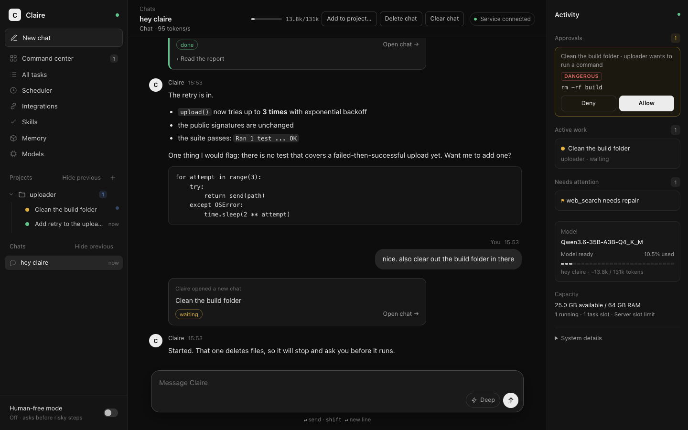
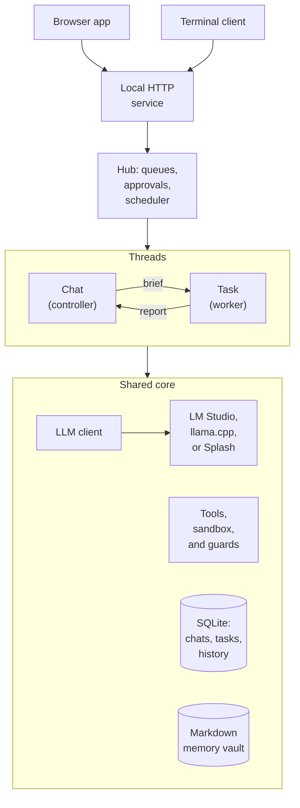

# Claire

Claire is a local AI assistant for coding, file work, and ongoing projects. You
talk to her in a browser or terminal; she can inspect files, edit code, run
approved commands, and delegate longer jobs to task threads that report back.



The model runs on your machine through **LM Studio**, **llama.cpp**, or the
optional **Splash runtime on macOS**. The core assistant needs no cloud API key
or hosted inference subscription. Chats, task history, and memory are stored
locally. Web searches and connected services use the network when you use them.

Claire includes:

- A local web app with chats, projects, task traces, and command approvals.
- Project memory and long-term notes stored as editable Markdown.
- Skills for coding, debugging, testing, research, and integration work.
- Scheduled tasks and optional connections to outside services.
- Native Mac app and browser controls on macOS; Windows supports the core
  assistant with the platform limits described below.

[Clone and start](#clone-and-start) · [Architecture](#architecture) ·
[Using Claire](#using-claire) · [Configuration](#configuration) ·
[Platform support and safety](#platform-support-and-safety) ·
[Development and testing](#development-and-testing) · [Troubleshooting](#troubleshooting)

## Clone and start

### Requirements

| Requirement | What you need |
| --- | --- |
| Git | To clone this repository. |
| Python | Python 3.9 or newer. The Windows setup script can also use an installed `uv` to create a Python 3.12 environment. |
| A local model runtime | The startup steps below use [LM Studio](https://lmstudio.ai). A llama.cpp alternative is included afterward. |
| A downloaded model | A language model that follows instructions and tool calls, with enough RAM and disk space for its weights and context. Model weights are not included in this repository. |
| A browser | The web app is served by Python; no Node.js installation, frontend build, or npm install is needed to use it. |

### 1. Clone the repository

```bash
git clone https://github.com/SohamNehra/Claire-V2.git
cd Claire-V2
```

Follow the startup instructions for your operating system from this folder.
Choose your own model before chatting: the profiles in `config.py` include
machine-specific paths that may not exist on a fresh installation.

### 2. Start Claire

#### macOS (with LM Studio)

Check Python, then start LM Studio with a downloaded language model. Enable
LM Studio's local server on `127.0.0.1:1234`. If its `lms` CLI is installed,
you can start the server and list your downloaded model keys from Terminal:

```bash
python3 --version
lms server start --port 1234 --bind 127.0.0.1
lms ls
```

Register the model using the key LM Studio lists. Replace `YOUR_MODEL_KEY`
below with that key:

```bash
./claire2 models add-lmstudio YOUR_MODEL_KEY --name "Local model" --context 32768
./claire2 models use local-model
./claire2 app
```

The add command prints the registered name; use that name if it differs from
`local-model`. Set a smaller context if your model or available memory requires
it. The Mac core uses Python's standard library and needs no pip installation.

`./claire2 app` starts Claire in the background and opens the signed-in app.
The service listens on **`http://127.0.0.1:8765`** by default. Model loading can
take longer than the web page's startup.

#### macOS with llama.cpp instead

To load a GGUF file directly instead of serving it through LM Studio, install
llama.cpp and register the file:

```bash
brew install llama.cpp
./claire2 models add "/absolute/path/to/model.gguf" --name "Local GGUF" --context 32768
./claire2 models use local-gguf
./claire2 app
```

Use the registered name printed by the add command. For a split GGUF, keep all
parts together and select the file ending in `00001-of-…gguf`. The model choice
overrides the saved runtime profiles, so you do not need to install Splash.

#### Windows

Install LM Studio and download a language model in it. Then run these commands
in PowerShell:

```powershell
powershell -NoProfile -ExecutionPolicy Bypass -File ".\Setup Claire.ps1"
& ".\Start Claire.cmd"
```

You can also double-click **Setup Claire.cmd** once, then **Start Claire.cmd**.
Setup creates a project-local `.venv` and installs `tzdata` and `tzlocal` for
Windows timezone support. It does not change the system execution policy.

The launcher starts LM Studio's local server on `127.0.0.1:1234` if needed,
starts Claire's background service, and opens the signed-in app in your browser.
If Claire has no saved model choice and LM Studio has exactly one downloaded
language model, that model is selected automatically. With several models,
open **Models → Add model → LM Studio**, choose one, and use **Restart Claire
now** before chatting.

If LM Studio's CLI is unavailable, start its local server on port `1234` in
LM Studio first, then run the Claire launcher again.

Windows state and notes stay beside the clone in `.claire/` and
`claire-vault/`. Desktop, Documents, and other standard folders are resolved
through Windows, including OneDrive redirection.

Linux can run the core using Python and an appropriate local model server,
but the Mac sandbox and native integrations are unavailable. The Windows
launcher above is the native Windows path; WSL is not required for it.

### 3. Check and manage the service

Closing the browser leaves Claire running so tasks can finish. Use the
launcher again to reopen the app with its sign-in link.

**macOS:**

```bash
./claire2 status          # Service, model, and context information
./claire2 app             # Open the app; start the service if needed
./claire2 serve           # Run the service in the foreground
./claire2 stop            # Stop Claire; leave the model loaded
./claire2 stop --unload   # Stop Claire and unload her managed local models
```

**Windows:**

```powershell
powershell -NoProfile -ExecutionPolicy Bypass -File .\claire2.ps1 status
powershell -NoProfile -ExecutionPolicy Bypass -File .\claire2.ps1 app
powershell -NoProfile -ExecutionPolicy Bypass -File .\claire2.ps1 serve
powershell -NoProfile -ExecutionPolicy Bypass -File .\claire2.ps1 stop
powershell -NoProfile -ExecutionPolicy Bypass -File .\claire2.ps1 stop --unload
```

macOS also supports `./claire2 autostart on` and `./claire2 autostart off` for
login startup through launchd. Windows has no equivalent built-in login item.

## Architecture

Claire v2 separates the browser, local service, agent loop, and model runtime.
The Python service owns the work; the web app displays its events and lets you
send messages and answer approvals.



Chats and tasks are both threads that run the same agent loop on one shared
core; a chat runs it with the controller's rules (answer, or hand the work on)
and a task with a worker's (do the work in its folder, then report). The
scheduler starts tasks through the hub like any other request. SQLite is the
record of what happened, so chats and task traces survive a restart; the
Markdown vault is what Claire remembers and reads back as context.

1. **Conversation and routing.** A chat controller answers ordinary messages,
   uses bounded local file actions, or starts a task with a brief, working
   directory, and relevant skills. It uses schema-constrained JSON decisions
   and a bounded recent conversation window; full history remains stored.
   Code changes and figures computed from data (totals, averages, growth) always
   go to a worker, which computes them with code rather than estimating. If a
   quick attempt fails, the request is handed to a worker, and the chat shows
   the handoff rather than the failed attempt. Figures in a brief that neither
   you nor a tool supplied are marked for the worker as unverified.
2. **Task execution.** Workers run the agent loop with their project's memory
   and tools. The loop calls the model, parses tool requests, checks access,
   obtains approvals when required, and records results. Task reports return
   to the chat that requested the work. A worker that repeats exactly the same
   step with the same result is told so on the third time, with the earlier
   copies taken out of its view and the next step sampled with some variety (at
   temperature 0 a model otherwise tends to copy itself), and stopped on the
   fourth. A worker stopped by a guard (repeating a step, no progress, or out of
   steps) is asked once for its own report, with no further tools; the report
   returns with the reason it was stopped and the files that actually changed.
3. **Live events.** The engine emits events instead of printing directly. The
   hub schedules chat and task work, while the HTTP service streams activity
   to the browser. Terminal rendering uses the same event structure. Terminal
   task mode can also run the engine directly without the service.
4. **Persistence.** SQLite holds threads, messages, events, approvals, schedules,
   projects, integrations, and tool health. The Markdown vault holds identity notes, project briefs,
   work logs, learned notes, and task reports.

One local model can handle every role. `ROLES` in `config.py` can assign
separate conversation, scout, clerk, worker, or vision models. A role without
its own model falls back to the main model. Model lifecycle code handles
loading, optional preloading, idle release, and managed unloads.

### Repository layout

| Path | Responsibility |
| --- | --- |
| `claire2`, `claire2.ps1` | Mac/POSIX and Windows v2 launchers. |
| `claire_core/cli.py`, `client.py`, `render.py`, `tui.py` | Terminal commands, service client, and rendering. |
| `claire_core/service.py`, `hub.py` | Local HTTP API, browser authentication, events, thread queues, and approvals. |
| `claire_core/engine.py`, `controller.py`, `protocol.py` | Agent loop, chat decisions, and tool-call parsing. |
| `claire_core/llm.py`, `boot.py`, `power.py`, `splash.py` | Model requests, runtime startup, loading, and idle lifecycle. |
| `claire_core/guard.py`, `host.py`, `resources.py` | Access rules, OS-specific paths, shell execution, and memory budgets. |
| `claire_core/store.py`, `projects.py`, `vault.py`, `worklog.py` | Persistent state, project membership, and memory. |
| `claire_core/scheduler.py` | Recurring jobs dispatched as ordinary tasks. |
| `claire_core/tools/`, `prompts/`, `skills/` | Built-in tools, prompt components, and working procedures. |
| `claire_core/connectors/`, `computer.py`, `vision.py` | External services and native Mac computer/vision capabilities. |
| `claire_core/web/` | The browser app: plain HTML, CSS, and JavaScript. |
| `config.py` | Runtime profiles and documented configuration. |
| `tests/`, `scripts/` | Regression tests, live evaluations, and runtime utilities. |

## Using Claire

### Chats, projects, and tasks

Start a chat from **New chat**, the command center, or a project page. Ask a
question directly, or give Claire a task and an existing project folder, such
as “Add tests for the parser in my project.” Longer work gets its own task
thread, trace, and report. Approval requests appear in the app's Activity panel.

A project can be a folder of work or a named group of chats. Tasks are filed
under the project that owns their working directory; scratch and standard OS
folders do not automatically become projects. Removing a project from the
list keeps its folder and stored memory.

The command center shows activity across projects, scheduled work, and task
status. **Hide previous / Show previous** controls change sidebar visibility
without deleting conversations or task history.

### Memory

Each project has a vault folder containing:

- `PROJECT.md`: what the project is and how work should be done there.
- `work/`: a dated record of work as tasks start and finish.
- `tasks/`: completed task reports.

Chats and tasks receive their own project context and a compact shared memory
index. `recall` retrieves detail by words or a note path. `MEMORY.md` is a
generated index: edit the underlying notes rather than the index itself.

The vault is plain Markdown and can be opened in Obsidian or another editor.
Identity notes live under `identity/`; user skills live under `skills/`.

### Skills and extensions

Skills are Markdown instructions for particular kinds of work. Built-in
procedures cover coding, debugging, testing, UAT, research, reviews, and
integrations. Add or edit your own skills in the app or with
`claire2 skills add FILE.md`. A user skill can override a built-in name.

Tasks can start with named skills, load a skill with `use_skill`, or receive
skills marked `always: true`. Frontmatter supports dependencies and routing
metadata. Skill changes are picked up on the next turn; Python engine changes
require a service restart. Skill selection is model-driven and can be imperfect.

On a supported Mac sandbox, the workshop can execute model-written Python and
register a tested tool. Broken tools are recorded in tool health and can leave
repair notes in the inbox. Built-in tools cannot be replaced by workshop tools.
Use `claire2 tools reset NAME` after repairing a broken tool.

### Integrations and computer use

The **Integrations** page connects supported services. Available providers
include Google services, HTTPS APIs, and MCP servers. Google connections need
your own OAuth client. The backend stores and attaches credentials; tool
arguments do not give the model those credentials. External results are marked
as untrusted data, and operations that change outside data require approval.

macOS additionally supports Apple Notes, a dedicated Playwright browser, and
native control of apps you explicitly allow. Native actions use scoped
observations and verified receipts. Visual questions use a separately configured
image-capable local model; listing Desktop files does not provide screen vision.

Windows marks Mac-only integrations unavailable. It supports remote API and
HTTP MCP connections, but the local sandboxed browser, stdio MCP, and workshop
execution require the Mac sandbox. See [platform support](#platform-support-and-safety).

### Scheduled work

Ask Claire to create a recurring task, then approve the schedule. Each run is
an ordinary task with its own trace and result. Schedules live in Claire's
database, not the system crontab, and run only while her service is running.

A job does not overlap itself or run more often than every ten minutes. After
downtime, a missed job can run once if it is within the configured grace
period; the shipped default is twelve hours.

## Configuration

### Models and roles

Use **Models** in the app or `claire2 models` to register and select a model.
Model choices are saved in `models.json` inside the state directory. A saved
selection takes precedence over `config.py`; explicit API, model, or worker
profile overrides take precedence over that selection.

After changing the selected model, use **Restart Claire now**, or stop and
start the service. The app refuses to restart while a chat or task is still
working, and unloads the models it manages before switching. Added llama.cpp models use dedicated
server ports starting at `8090`.

`ROLES` can assign the main reasoning model, conversation controller, scouts,
summary clerk, and vision specialists to different runtimes. The scout tool
reads bundles of material with a question and returns a compact report. The
worker receives its task brief and relevant project context without the whole
chat's persona or global diary.

The repository also includes Mac-specific Splash profiles and runtime tooling.
Their model names, context settings, performance measurements, installation,
and rollback instructions are in [CLAIRE_SPLASH_UPGRADE.md](CLAIRE_SPLASH_UPGRADE.md).

### Storage locations

| Data | macOS/default Python CLI | Windows launcher |
| --- | --- | --- |
| Threads, approvals, schedules, model registry, service token | `~/.claire/` | `<clone>/.claire/` |
| Markdown memory vault | `~/claire-vault/` | `<clone>/claire-vault/` |
| Service log | `~/.claire/service.log` | `<clone>/.claire/service.log` |

`CLAIRE_STATE` and `CLAIRE_VAULT` override these locations. Use the Windows
launcher consistently so commands target the same state directory as the app.
Local state, vault notes, virtual environments, and temporary artifacts are
excluded by `.gitignore`.

### Important settings

| Setting | Purpose |
| --- | --- |
| `SERVICE_PORT` / `CLAIRE_SERVICE_PORT` | Claire's loopback HTTP port; default `8765`. |
| `ROLES`, `WORKER_PROFILE` | Model assignments and optional runtime profiles. |
| `CONTROLLER_ENABLED`, `CONTROLLER_HISTORY_CHARS`, `CONTROLLER_MAX_STEPS` | Conversation routing and context/step limits. |
| `WORKER_CONTEXT`, `MAX_TASK_WORKERS` | Worker context and task concurrency. |
| `PRELOAD_MODEL` | Load the main model when the service starts. |
| `MODEL_IDLE_SECONDS` / `CLAIRE_MODEL_IDLE_SECONDS` | Release managed models after inactivity; `0` keeps them loaded. |
| `TEMPERATURE`, `THINKING` | Generation and reasoning defaults. |
| `SANDBOX`, `APPROVAL_TIMEOUT` | Sandbox selection and approval expiry. |
| `ROLES`, `VISION_UNLOAD_AFTER_USE`, `COMPUTER_MAX_STEPS` | Mac vision models and computer-use limits. |

Other environment overrides include `CLAIRE_API`, `CLAIRE_MODEL`,
`CLAIRE_WORKER_PROFILE`, `CLAIRE_THINKING`, and `CLAIRE_YOLO`. Restart the
background service for changed configuration or environment settings to take
effect. `python3 config.py` inspects the file-level configuration; use
`claire2 status` and the app to check the running service and saved model choice.

For the configured LM Studio Qwen3.8 27B mapping, ordinary mode sends
`reasoning_effort: none`; deeper thinking defaults to `medium`.
`CLAIRE_LMSTUDIO_REASONING_EFFORT=low|medium|xhigh` sets that deeper effort.
Other models and runtimes can interpret reasoning controls differently.

Idle release keeps the service and scheduler running. A new message or due
job reloads its managed model when needed. Real activity keeps Claire awake;
background status polling does not. Externally managed endpoints are left
running. The current idle timeout is configured rather than fixed at thirty
minutes.

## Platform support and safety

| Capability | macOS | Windows |
| --- | --- | --- |
| Local-model chat, project/task work, memory, and schedules | Available | Available |
| Shell commands | POSIX shell, with Seatbelt when available | PowerShell, with approvals and pattern guards |
| Standard folders | Mac folder layout | OS-known folders, including OneDrive redirection |
| Remote API and HTTP MCP integrations | Available | Available |
| Native Mac app controls and Apple Notes | Require setup and permissions | Unavailable |
| Local sandboxed Browser/stdio MCP and workshop execution | Require the Mac OS sandbox | Unavailable |
| Finder folder/model chooser and login autostart | Available | Use typed paths; no built-in login autostart |
| Splash runtime | Optional Mac runtime | Unavailable |

Safety is enforced at several levels:

- **Access checks:** file tools resolve targets, block protected paths, and
  constrain task file access to the assigned working directory. The chat's
  bounded filesystem tool can browse non-secret directories outside a task;
  file changes require a user-established target.
- **OS isolation on macOS:** Seatbelt confines supported shell/tool processes.
  Stricter workshop profiles restrict filesystem and network access.
- **Command rules and approvals:** forbidden commands are refused, and commands
  requiring review wait for approval. `--yolo` and the app's human-free mode
  do not remove the forbidden list or the OS sandbox. Human-free mode still
  retains approvals for destructive and other consequential actions.
- **Local API protection:** the service binds to `127.0.0.1`, checks Host and
  Origin, and requires authentication. The app exchanges its startup token
  for an HttpOnly, SameSite cookie. A strict content security policy and text
  rendering keep model output from becoming executable page markup.

Windows and Linux have no equivalent OS sandbox in this implementation.
Pattern guards and approvals do not provide kernel isolation. Native app
control and visual screen access are separate from filesystem browsing.

Credentials use the macOS keychain when available; the fallback secret backend
uses a file in the state directory. See
[Windows compatibility notes](docs/WINDOWS_COMPATIBILITY.md) for the verified
Windows scope, regression results, and outstanding Mac acceptance checks.

## Command reference

On macOS, run these as `./claire2 …`. On Windows, pass the same arguments after
`powershell -NoProfile -ExecutionPolicy Bypass -File .\claire2.ps1`.

| Command | Purpose |
| --- | --- |
| `app`, `status`, `serve`, `stop [--unload]` | Open, inspect, run, or stop the service. |
| `home` | Use the persistent terminal conversation through the service. |
| `"task"` | Run a task from the terminal in the current working directory. |
| `tasks`, `approvals`, `inbox` | Inspect task results, pending decisions, and notes. |
| `tools`, `tools reset NAME` | Inspect tool health or clear a repaired tool's fault. |
| `models` | List registered models and the selection. |
| `models add FILE.gguf`, `models add-lmstudio KEY` | Register a local file or LM Studio model. |
| `models use NAME`, `models remove NAME` | Select or remove a registration. |
| `skills`, `skills add FILE.md` | List or add working instructions. |
| `connectors`, `schedules` | Manage connections and recurring work. |
| `bench [brain\|scout]` | Evaluate a model on Claire's tasks. |
| `autostart on\|off` | Configure login startup on macOS. |

Use `--thinking` for deeper reasoning, `--model ID` for a model override, and
`--worker-profile NAME` for a configured worker profile. In an interactive
terminal session, `/t` toggles thinking, `/y` toggles automatic approval,
`reset` clears that conversation, and `exit` or `quit` ends the session.

## Development and testing

The core and web app use no frontend framework or build step. Windows adds
the timezone dependencies listed in `requirements-windows.txt`.

Run the model-free regression suite:

```bash
python3 -m unittest discover -s tests -t . -q
```

On Windows, use the project environment:

```powershell
.\.venv\Scripts\python.exe -m unittest discover -s tests -t . -q
```

With Node.js installed, run the frontend contracts and syntax check:

```bash
node --check claire_core/web/app.js
node tests/ui/frontend_checks.cjs
```

`tests/ui/run.sh` also drives the app against a scripted model in headless
Chrome; it needs the browser and its Node tooling. The
[platform workflow](.github/workflows/platform-tests.yml) runs regression and
frontend checks on Windows and macOS. Platform-specific tests can be skipped
when their OS feature or permission is unavailable; mocked contracts do not
replace native acceptance testing.

Live evaluations are separate from unit tests. These scripts currently assume
macOS temporary paths and runtime configuration; run them on a Mac with a
configured local model:

```bash
python3 -m tests.live_controller_eval
python3 -m tests.live_worker_eval
python3 -m tests.live_pipeline_eval
python3 -m tests.live_integration_eval
```

They exercise conversation routing, independent coding outcomes, worker
reporting, and integration repair using disposable state and fixtures.
`claire2 bench` records task outcomes and inference statistics; use `--history`
to inspect earlier reports. Historical results are not guarantees for a new
model or machine.

A built-in tool lives in `claire_core/tools/`, exports a `TOOLS` list, and has
its instructions under `claire_core/prompts/tools/`. The prompt's tool section
is generated from the registry. Integration tests should check the request
and response contract of every advertised action; offline fixture success is
separate from verification against a real connected account.

## Troubleshooting

Start with `claire2 status` using your OS launcher, then inspect `service.log`
in the corresponding state directory.

| Problem | What to check |
| --- | --- |
| Splash runtime or an old model path is missing | Register your own model and select it before starting. The saved choice overrides the repository's runtime profiles. |
| LM Studio is not answering | Start its local server on `127.0.0.1:1234`, check the downloaded model key, and rerun the launcher. |
| Windows reports a missing Python environment | Run **Setup Claire.cmd**, then **Start Claire.cmd**. |
| The model cannot load or generation is slow | Check runtime logs, available memory, and the selected model's context size. |
| The app opens but this browser is not signed in | Reopen it through `claire2 app` or **Start Claire.cmd** to obtain the startup sign-in link. |
| An old chat refers to a nonexistent Windows Desktop path | Restart Claire on the current code. Standard folders use OS discovery, including OneDrive redirection; `local_files` can report the current locations. |
| A project path is refused | Check that it is an existing project directory, not a drive root, system folder, Claire's code/state, or a credential store. |
| A Mac integration is unavailable on Windows | Check the platform support table; filesystem access does not enable native Mac app controls. |
| The page and service appear to use different versions | Stop the service, start it again, and reload the page. |
| Port `8765` is occupied | Check for an existing Claire service or change `SERVICE_PORT` / `CLAIRE_SERVICE_PORT`. |

## Further documentation

| Document | Contents |
| --- | --- |
| [Getting started](GETTING_STARTED.md) | Longer setup and usage walkthrough, with screenshots. |
| [Windows compatibility](docs/WINDOWS_COMPATIBILITY.md) | Windows implementation, verified scope, platform limits, and release checks. |
| [Routing review](CLAIRE_ROUTING_REVIEW.md) | Controller/worker design, evaluations, and model-role decisions. |
| [Navigation review](CLAIRE_NAVIGATION_REVIEW.md) | Filesystem discovery, task handoffs, and measured limitations. |
| [Splash runtime](CLAIRE_SPLASH_UPGRADE.md) | Mac runtime installation, model profiles, lifecycle, benchmarks, and rollback. |
| [Computer use](CLAIRE_COMPUTER_UPGRADE.md) | Native Mac controls, visual specialists, receipts, and acceptance checks. |
| [Tool review](CLAIRE_TOOL_REVIEW.md) | Tool contracts, reliability checks, and failure handling. |
| [Reliability review](CLAIRE_RELIABILITY_REVIEW.md) | Reliability changes and evaluation notes. |
| [Connector development](claire_core/connectors/README.md) | Connector architecture and extension details. |
| [Frontend/backend handoff](FRONTEND_BACKEND_HANDOFF.md) | Web app and service interface details. |

### Legacy v1 terminal client

`claire.py` and the `claire` bash launcher remain in the repository for the
original single-conversation terminal agent. They use `config.py` and a model
endpoint, without the v2 web service's project/thread management. Existing v1
users can continue with that client; the startup instructions in this README
use **Claire v2** through `claire2` and the Windows launchers.
